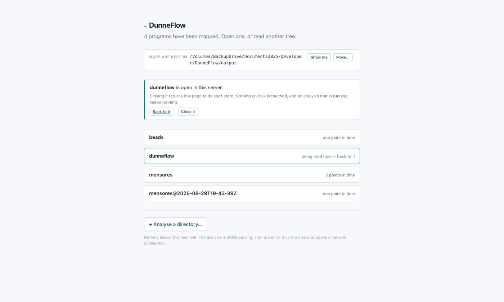

# 3. The start page

This is what DunneFlow serves when nothing is open. This describes the state in which a freshly installed
application begins.

It is deliberately **not** the dashboard with everything emptied out. The dashboard is an
application about one version of one program. There is a navigator counting its routines, a
cover, a stack, and an inspector. You must select something before these screens show any
information. You would get forty panes each explaining why it is blank,
before you had asked any of the questions.

By design, this page does two things and no more: it says what is here, and it offers the two
things you can do about it.

## What is on it

**The lead line** — *"4 programs have been mapped. Open one, or read another tree."* If
nothing has been mapped yet, it says that instead. This is the one place that tells you
whether the emptiness below is *nothing here* or *nothing found*.

**Maps are kept in** This describes the path and is selectable, with two buttons.

- **Show me** opens it in the Finder, in File Explorer on Windows, or in your file manager
  on Linux. Useful when you want to hand a map to a colleague, or delete one.
- **Move…** points DunneFlow somewhere else, and optionally carries the existing maps
  across. See [Installing](01-installing.md#moving-them-somewhere-else). Its **Choose…**
  button opens a folder chooser; on Windows that chooser can open *behind* your browser, so
  Alt-Tab to it if it does not appear. On Linux it needs zenity or kdialog installed, and
  names them if neither is available.

**The program list** This lists every directory under the maps root that actually holds a map.
Each row says how many points in time it holds: *one point in time*, or *3 points in
time* for a program you have analysed more than once. Click a row to open it.

DunneFlow decides what is a map by looking inside, never by the directory's name. A
folder called `output` full of hand-written prose is a folder full of prose, and it will
not appear here.

**+ Analyse a directory…** . This will read a new tree. That is [the next
chapter](04-your-first-map.md).

**The footer** Note that *"nothing leaves this machine. The analysis is stdlib parsing, and no
part of it calls a model or opens a network connection."* That is a standing guarantee
rather than a marketing line; there is a test that fails if anything on the analysis path
starts importing an HTTP client.

## When a map is already open

If a map is open and you come back here, such as by asking for `/start` by name, you get an
extra panel naming it, with two ways out:

- **Back to it** returns you to the dashboard. This is the common case, and it is why
  this page exists as a route at all: it is the way back if the dashboard ever stops
  working.
- **Close it** returns the server to its start state. Nothing on disk is touched, and an
  analysis that is running keeps running.

## When the maps disk is not there

If you moved your maps to an external disk and it is not plugged in, this page leads with
that, names the disk, and offers **Try again** and **Choose somewhere else**.

DunneFlow falls back to the standard location so that double-clicking the app does
*something* rather than nothing. If it fails, it says so loudly, because a silent substitution
would have you looking at an empty list on a machine where all your maps still exist.
What it will never do is *create* the missing directory. On a Mac, `/Volumes` is an
ordinary folder on your startup disk, so a helpful `mkdir` there would put a new empty maps
root on the very disk you were trying to keep clear; on Linux `/mnt` and `/media` are the
same trap one directory over; on Windows the same `mkdir` either fails on a drive letter
that is not there or writes to one that has been reassigned to something else. None of
those is an answer, so it does not guess.

---

Next: [4. Your first map](04-your-first-map.md)
