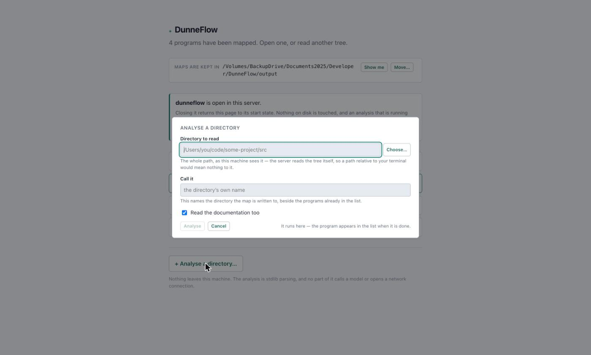
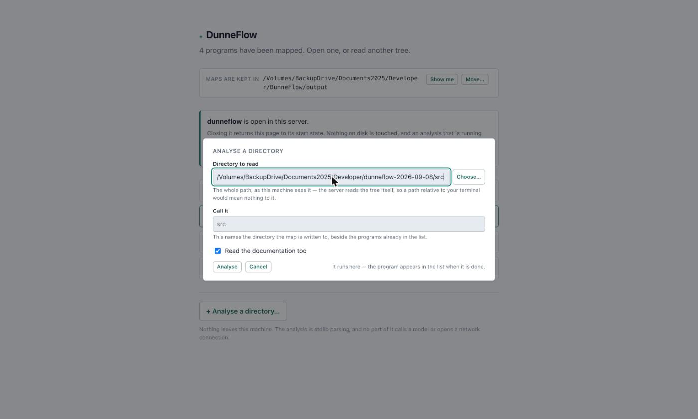
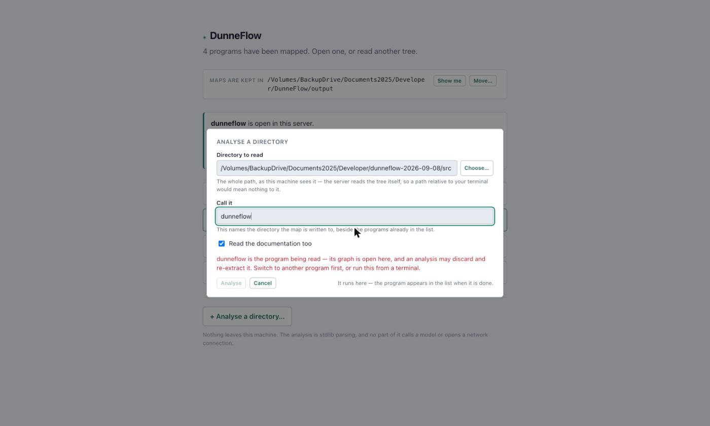
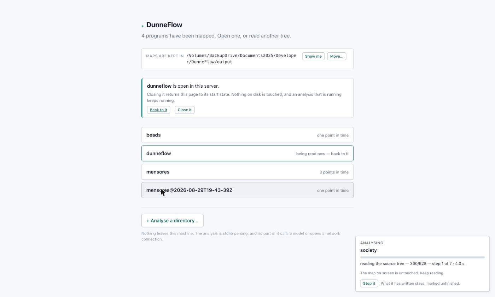
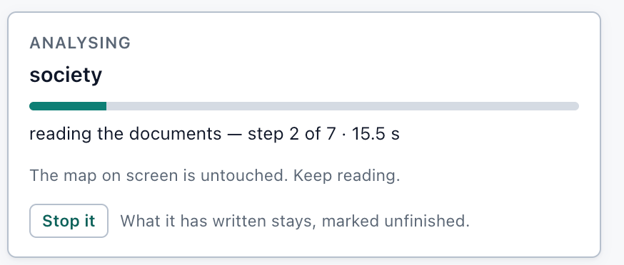
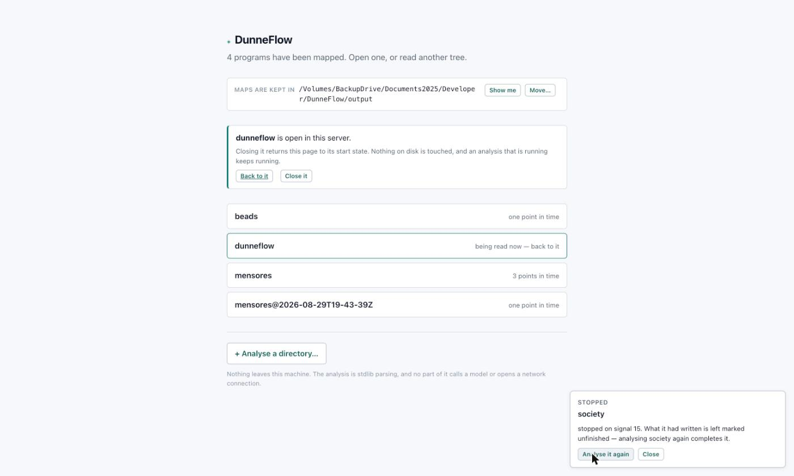

# 4. Your first map

Press **+ Analyse a directory…** on the start page. (The same dialog is on the program
menu inside the dashboard, as the last entry, so you never have to leave a map to read
another one.)



## The two fields

**Directory to read** — the whole path, as this machine sees it. Not a path relative to
your terminal: the server reads the tree itself, so a relative path would mean nothing to
it. **Choose…** opens a folder picker if you would rather not type one. The typed field
never goes away — the picker is a convenience over a control that still works.

Point it at the directory that holds the code. For a Python project that is usually
`src/`, or the package directory, rather than the repository root.

**Call it** — the name of the directory the map is written to, beside the programs
already in the list. Leave it and DunneFlow uses the directory's own name.

**Read the documentation too** — on by default. DunneFlow scans the Markdown, reStructuredText
and plain text beside the code and reads it as a separate, parallel corpus: it is what
fills the glossary, the naming lanes and Document mode's second lane. Turn it off if you
only want the code, and the analysis is quicker.

## The pre-flight

DunneFlow checks what you typed as you type it, and **Analyse** stays disabled until it
is satisfied.



When it refuses, it says which refusal it is — they are different problems and each has
its own sentence. The commonest one on your first run:



That one is not caution. An analysis into the name that is currently open would rewrite
the very graph the server is holding, and empty the map under you while you were reading
it. The others — a relative path, a directory that is not there, a standards directory
nested inside the tree — each get their own sentence too. See
[when it refuses](15-when-it-refuses.md).

Analysing into a name that **already exists** is allowed, and the dialog says plainly
that it rewrites that program's working snapshot.

## While it runs

The panel appears bottom-right and stays there. You can dismiss it, keep reading, and
come back — an analysis is not a switch, and the map you already have open stays open and
stays true for the whole run.



Close up:



The steps are counted for *this* run, not from a fixed list, because the flags you set
remove work. A full run is:

1. reading the source tree
2. reading the documents
3. capturing the document bodies
4. reading the standards *(only if you gave it a standards directory)*
5. resolving calls and command trees
6. capturing the source bodies
7. writing the map
8. looking for anomalies

If the panel says nothing has moved for several minutes, it tells you that and does
nothing about it. Resolution is legitimately quiet for tens of seconds on a large
program, so whether that is a wedged job or a long step is your call, not the tool's.

## Stopping it

**Stop it** ends the run. What it had already written stays on disk, **marked
unfinished** — and that mark is the point of the whole mechanism.



An analysis that is killed part-way leaves a graph that **opens perfectly and lies**. One
stopped twelve seconds into a large program reported 628 files, 4,786 routines and *zero*
resolved calls, over a timestamp and a tool version, looking for all the world like a
finished map of a program with no internal calls in it. So DunneFlow records whether its
own analysis finished, and every reader that vouches for a map checks:

```
error: society was never finished: an analysis stopped while reading the documents.
What it holds is part of a program, not a program. Analysing it again completes it —
the extraction is cached, so it takes seconds rather than the whole run.
```

Analysing again does complete it, and it is quick: extraction is cached against the
content of each file, so the second run only does the work the first one did not reach.

A stopped run is reported as **stopped**, not as failed. You did it on purpose.

## What you get

A directory under the maps root, holding:

- **`graph@<instant>.db`** — the one source of truth. Every fact about the program, in
  SQLite. Nothing holds the whole program in memory; every question the dashboard asks is
  a query against this.
- **`docs@<instant>.db`** — the documentation, in a parallel store. Never the same file:
  a documentation rescan never touches the graph, and a corpus stays a separately
  handable thing. Many people will hand you a charter and never a line of source.
- **`source.db`** and **`docsource.db`** — the bodies of what was read, held by content
  hash. This is what lets [Code mode](09-code.md) show you the source months later, on a
  machine that has never held the tree.
- **`map@<instant>/`** — fifteen Markdown documents about the program: entrypoints,
  flows, routines, data, boundaries, governance, database, network, anomalies, glossary,
  naming, traceability, mirror, constants, and a README that indexes them. These are the
  same eight subjects [Document mode](08-document.md) shows you in the browser, plus the
  ones that only make sense written down.

The Markdown is readable on its own with no tooling at all, which matters when you want
to send someone the answer rather than the application.

Then the dashboard opens. That is [the shell](05-the-shell.md).

---

Next: [5. The shell](05-the-shell.md)
