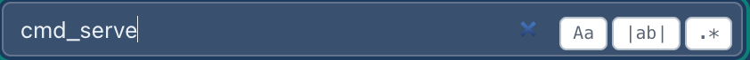

# 5. The shell

![The DunneFlow dashboard on the cover of dunneflow: the top bar (program menu "dunneflow — 142 files", SOURCE DIRECTORY DunneFlow, the version menu, the search box, the scale slider, System and Settings); the version strip comparing with dunneflow-before-windows and "assuming the compared version is newer"; the navigator on the left with Routines open, "1,552 in 24 packages — open one, or search"; the cover in the middle headed "dunneflow 142 files · 53,988 lines · 1,552 routines · analysed 2026-10-02 21:37 UTC" with WHERE TO START, WHAT IT TOUCHES 526 and WHAT LOOKS WRONG (Broken 0, Suspect 21, Informational 18); and the inspector railed on the right](images/05-shell-cover.jpg)

Three panes and a top bar. The important thing to understand before anything else is that
the middle is **one selection read six ways**, not six places to go. Pick a routine
anywhere, maybe a navigator row, a dot in the stack, a row in the table, or a line of source, and
all six views are already showing it. Switching view never loses your place.

## The top bar

**The program menu** (`dunneflow — 142 files`) switches between every program under your
maps root. Its last two entries are **+ Analyse a directory…**, so you can read a new tree
without going back to the start page, and **× Close this map**, which puts you back on the
start page with nothing open.

**source directory** is a button, not a label. It opens *About this map*: what read it,
when, and the two rows it exists for:

| Inferred facts | none — every fact here was read, not guessed |
| Read by a model | none — this analysis is deterministic and local |

Those are a standing guarantee rather than a placeholder waiting for a model to be wired
in. Nothing on the analysis path calls a model or opens a network connection.

It shows the **leaf** of the directory the map was read from, never the path. A path is
one machine's layout, in an artefact built to be handed to someone else.

*About this map* also says what the map holds and **what was left out of it**: which
languages were read and how many files of each, the suffixes no reader claimed, and every
other filter the run applied. There is a picture of it in
[Installing](01-installing.md#which-languages-it-reads-and-the-one-thing-you-may-have-to-install).
**Analyse this again…** at its foot opens the analyse dialog with the program's name filled
in and the directory left blank — the map records the leaf and never the path, so the path
is yours to supply.

**The version menu** picks which point in time you are reading, and what it is held
against. With one version it is not drawn at all. See [comparing two
versions](14-comparing-two-versions.md).

**The search box** searches names and meanings — routines, tables, boundaries — across
every navigator group at once. Press `/` from anywhere to jump into it. The three flags
beside it are `Aa` (match case), `|ab|` (whole word) and `.*` (regular expression):

This is *not* the same question as the Code group's search box, which searches the **text**
of the source. That might be a word inside a comment, inside a string literal, or on a line that carries
neither. Two boxes, two genuinely different questions.

**The scale slider** is one multiplier over everything: type, column widths, row heights,
icons, and the size of nodes in the graph. Not a browser zoom, the layout re-flows.

## The version strip

The line under the top bar. **Always present**, on every screen, whether or not a
comparison is running, because the one thing you must never have to infer from an
absence is whether what you are looking at is a comparison.

With nothing compared it says so in as many words, and it says **which kind of nothing**:

| | |
|---|---|
| *version DunneFlow 0.2.0 — on its own; this program has only one version* | there is nothing to compare |
| *version DunneFlow 0.2.0 — on its own, nothing compared* | there is, and you chose not to |

One is a limit of the map and the other is a switch you can throw. Reporting both the same
way would leave the second looking like the first.

With a comparison running, it names both sides and what it is assuming about their order —
*BASE DunneFlow 0.2.0 compared with dunneflow-before-windows · DunneFlow at 1017ef4 - before
the Windows fix 0.2.0*, then a button reading *assuming the compared version is newer*. That
is in [comparing two versions](14-comparing-two-versions.md).

## The navigator

Twelve groups, each counting the program rather than reciting a fixed list.

| Group | What is in it |
|---|---|
| **Ways in** | Every way the program can be started: command-line entry points, HTTP routes, registered handlers. Ranked by how much of the program each one commands. |
| **Routines** | All of them, by package. |
| **Changes** | What differs from the compared version. Empty-headed until you set one. |
| **Code** | Every file, and a text search over the source. |
| **Explore** | *Worth a look* Measured extrema, each with its middle stated and *Kept*, your shelf. |
| **Packages** | The largest packages, by what they hold. |
| **Boundaries** | Everything that leaves the program: DATABASE, FILE, STDIO, NETWORK, LOCAL_IPC, PROCESS, CRYPTO, ENV… LOCAL_IPC is a Unix-domain socket: another process on the same machine, never the network. |
| **Database** | Every table the code names, and who reads and writes it. |
| **Structures** | Classes, dataclasses, enums, type aliases. |
| **Vocabulary** | The glossary, the derived naming standard, the stated naming rules, and which of those rules could be checked. |
| **Algorithms** | Loops and decisions, in five lanes. See [Shape](11-shape.md). |
| **Anomalies** | The worklist: Broken, Suspect, Informational. |

By default one group stands open at a time, because a program with four thousand routines
puts every menu below Routines two hundred rows out of reach. Both behaviours are built —
see [Settings](13-settings.md).

**No filter is ever silent.** Type in the search box and every group tells you what it did
with your query, including the ones that found nothing:

That matters more than it looks. A group that quietly showed nothing would be
indistinguishable from a group that has nothing.

The two numbers beside a routine, `1← 7→`, are its callers and its callees, one hop away.
They come from the graph, so they appear once the graph has been opened; before that the
column is blank rather than zero, because a count nobody has taken is not a count of
nothing.

## The inspector

Everything known about the current selection, on the right.

![The inspector for cli.cmd_serve, cli.py:2033–2100: ANALYSED and ROUTINE tags, "◇ Keep this" and "Collapse all" buttons, then IN 2 — serve, tagged CLI, and build_parser in cli, CERTAIN — with its docstring "Open the map. Read-only throughout -- serving can never damage what it shows.", then OUT "14 call sites" beginning Path EXTERNAL, default_output_root (runtime) CERTAIN, str EXTERNAL, platform_output_root (runtime) CERTAIN, _emit (cli) CERTAIN twice, given.mkdir at the boundary EXTERNAL, _emit (cli) CERTAIN, already_serving (web.serve) CERTAIN, where (web.serve) CERTAIN, _emit (cli) CERTAIN, webbrowser.open EXTERNAL and serve (web.serve) CERTAIN](images/05-inspector.png)

- **IN** What calls this, and how sure DunneFlow is about each: `CERTAIN`, `INFERRED`,
  `EXTERNAL`. A way in is listed here too, tagged by its kind — `serve` above is the
  `dunneflow serve` command. Confidence is drawn as shape and wording, never as colour alone.
- **OUT** What it calls, with the package each lives in, counted in **call sites**: `_emit`
  called four times is four rows. A call that leaves the program is marked *at the
  boundary*, and building one of the program's own classes is marked *a class of this
  program*.
- **TOUCHES** What it moves in or out of the program: the SQL it runs, the files it
  opens, what it writes to a stream.
- **SHAPE** Its loops, guards and decisions, counted, with **Draw its shape** to see them.
  That is [Shape](11-shape.md).
- **GOVERNANCE** The plans, tickets and decision ids attached to it.
- **THREADS TO PULL** Reasons something *else* is worth a detour. That is [chasing
  rabbits](12-chasing-rabbits.md).
- **SIGNATURE** and **Show source** The declaration, and the code.

The inspector rails itself away while nothing is selected, and comes back when something
is. Every pane collapses to a labelled rail rather than vanishing, so you can always tell
that the layout is a choice you made and get it back.

## Keyboard

| | |
|---|---|
| `/` | jump to the search box |
| `⌘Z` / `⇧⌘Z` (`Ctrl+Z` / `Ctrl+Shift+Z` on Windows and Linux) | Back and Forward along the trail, from anywhere |
| `Enter` | open the detail window for whatever the pointer is over in the graph |
| `s` | show or hide the source pane in the inspector |
| `Esc` | close the source viewer, then the detail window, in that order |
| `j` / `k` | next / previous finding, in the anomaly worklist |
| `1` / `2` / `3` | triage the finding under the cursor: not a bug · acknowledged · a defect in DunneFlow |

---

Next: [6. Graph](06-graph.md)
