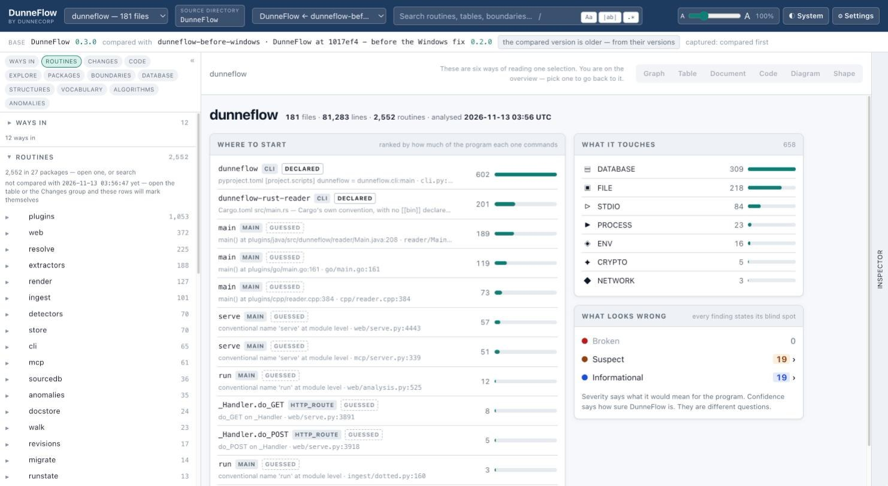
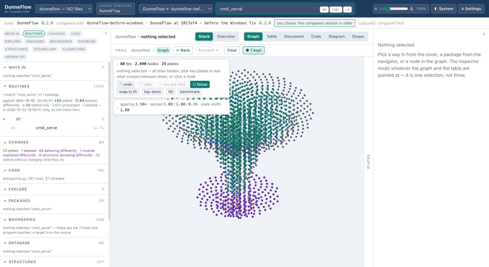

# 5. The shell

Three panes and a top bar. The important thing to understand before anything else is that
the middle is **one selection read six ways**, not six places to go. Pick a routine
anywhere — a navigator row, a dot in the stack, a row in the table, a line of source — and
all six views are already showing it. Switching view never loses your place.

## The top bar

**The program menu** (`dunneflow — 78 files`) switches between every program under your
maps root. Its last entry is **+ Analyse a directory…**, so you can read a new tree
without going back to the start page.

**source directory** is a button, not a label. It opens *About this map*: what read it,
when, and — the two rows it exists for —

| Inferred facts | none — every fact here was read, not guessed |
| Read by a model | none — this analysis is deterministic and local |

Those are a standing guarantee rather than a placeholder waiting for a model to be wired
in. Nothing on the analysis path calls a model or opens a network connection.

It shows the **leaf** of the directory the map was read from, never the path. A path is
one machine's layout, in an artefact built to be handed to someone else.

**The version menu** picks which point in time you are reading, and what it is held
against. With one version it is not drawn at all. See [comparing two
versions](14-comparing-two-versions.md).

**The search box** searches names and meanings — routines, tables, boundaries — across
every navigator group at once. Press `/` from anywhere to jump into it. The three flags
beside it are `Aa` (match case), `|ab|` (whole word) and `.*` (regular expression).

This is *not* the same question as the Code group's search box, which searches the **text**
of the source — a word inside a comment, inside a string literal, on a line that carries
neither. Two boxes, two genuinely different questions.

**The scale slider** is one multiplier over everything: type, column widths, row heights,
icons, and the size of nodes in the graph. Not a browser zoom — the layout re-flows.

## The version strip

The line under the top bar. **Always present**, on every screen, whether or not a
comparison is running — because the one thing you must never have to infer from an
absence is whether what you are looking at is a comparison.

With one version, or with a comparison switched off, it says so in as many words:
*version DunneFlow 0.1.0 — on its own, nothing compared.*

## The navigator

Twelve groups, each counting the program rather than reciting a fixed list.

| Group | What is in it |
|---|---|
| **Ways in** | Every way the program can be started: command-line entry points, HTTP routes, registered handlers. Ranked by how much of the program each one commands. |
| **Routines** | All of them, by package. |
| **Changes** | What differs from the compared version. Empty-headed until you set one. |
| **Code** | Every file, and a text search over the source. |
| **Explore** | *Worth a look* — measured extrema, each with its middle stated — and *Kept*, your shelf. |
| **Packages** | The largest packages, by what they hold. |
| **Boundaries** | Everything that leaves the program: DATABASE, FILE, STDIO, NETWORK, PROCESS, CRYPTO, ENV… |
| **Database** | Every table the code names, and who reads and writes it. |
| **Structures** | Classes, dataclasses, enums, type aliases. |
| **Vocabulary** | The glossary, the derived naming standard, the stated naming rules, and which of those rules could be checked. |
| **Algorithms** | Loops and decisions, in five lanes. See [Shape](11-shape.md). |
| **Anomalies** | The worklist: Broken, Suspect, Informational. |

By default one group stands open at a time, because a program with four thousand routines
puts every menu below Routines two hundred rows out of reach. Both behaviours are built —
see [Settings](13-settings.md).

**No filter is ever silent.** Type in the search box and every group tells you what it did
with your query, including the ones that found nothing:

That matters more than it looks. A group that quietly showed nothing would be
indistinguishable from a group that has nothing.

## The inspector

Everything known about the current selection, on the right.

- **IN** — what calls this, and how sure DunneFlow is about each: `CERTAIN`, `INFERRED`,
  `EXTERNAL`. Confidence is drawn as shape and wording, never as colour alone.
- **OUT** — what it calls, with the package each lives in.
- **TOUCHES** — what it moves in or out of the program: the SQL it runs, the files it
  opens, what it writes to a stream.
- **GOVERNANCE** — the plans, tickets and decision ids attached to it.
- **THREADS TO PULL** — reasons something *else* is worth a detour. That is [chasing
  rabbits](12-chasing-rabbits.md).
- **SIGNATURE** and **Show source** — the declaration, and the code.

The inspector rails itself away while nothing is selected, and comes back when something
is. Every pane collapses to a labelled rail rather than vanishing, so you can always tell
that the layout is a choice you made and get it back.

## Keyboard

| | |
|---|---|
| `/` | jump to the search box |
| `⌘Z` / `⇧⌘Z` (`Ctrl+Z` / `Ctrl+Shift+Z` on Windows) | Back and Forward along the trail, from anywhere |
| `Enter` | open the detail window for whatever the pointer is over in the graph |
| `s` | show or hide the source pane in the inspector |
| `Esc` | close the source viewer, then the detail window, in that order |
| `j` / `k` | next / previous finding, in the anomaly worklist |
| `1` / `2` / `3` | triage the finding under the cursor: not a bug · acknowledged · a defect in DunneFlow |

---

Next: [6. Graph](06-graph.md)
