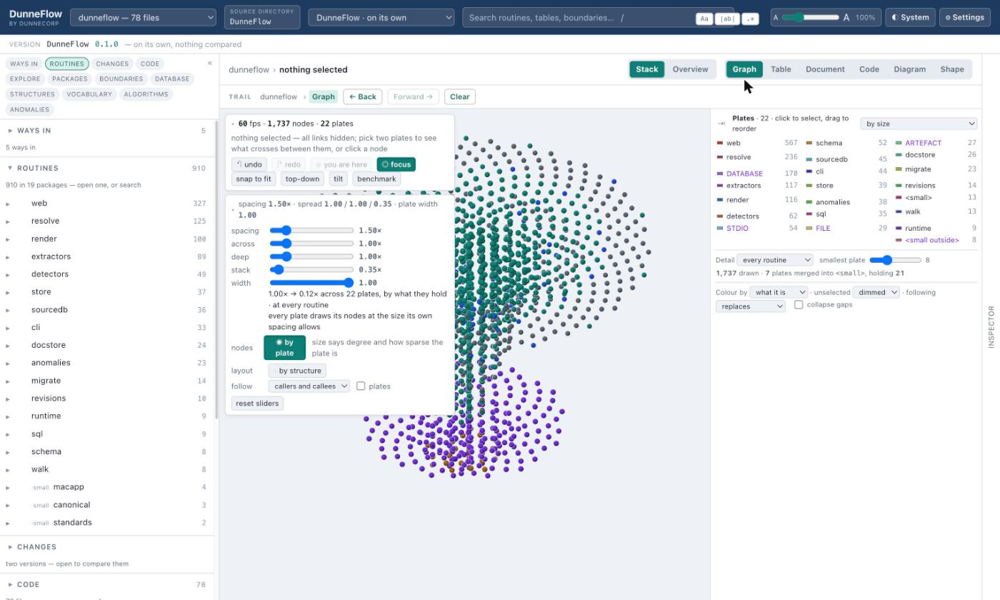
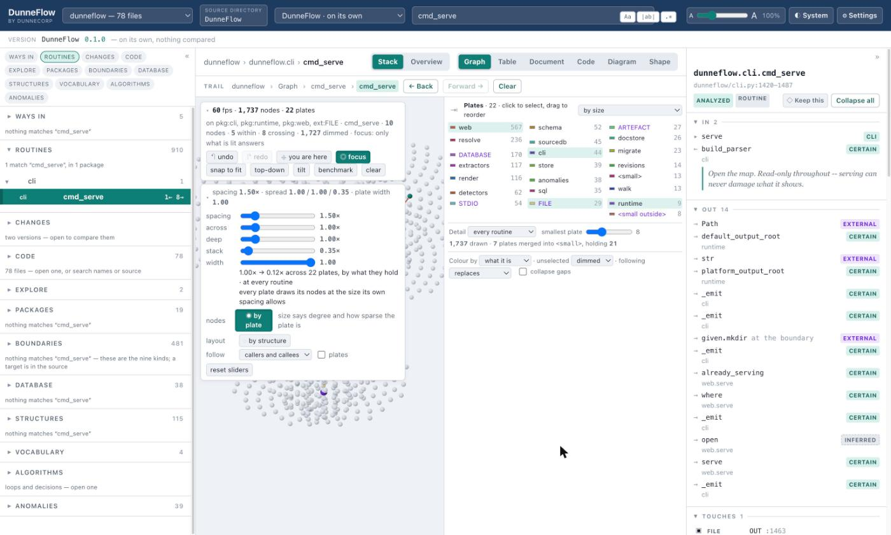

# 6. Graph

The whole program at once, as a stack of plates. Also known as 2.5D, or two and a half dimensional.

## What you are looking at

**A plate is a package**, or a kind of boundary or grouping. Everything the program declares sits on
the plate it belongs to, and the plates are stacked so you can see the whole program's
shape without anything overlapping anything else.

**A node is one thing the program declares** A routine, a constant, a structure. It is
drawn as a dot rather than a labelled box because at fifteen thousand of them a labelled
box is not a picture, it renders as a wall.

The legend on the right lists every plate with what it holds. Click one to select it;
drag to reorder.

**Some nodes are shadows and are never drawn.** When a routine on one plate calls a
routine on another, the model puts a placeholder for the far end on *this* plate, so the
crossing can be expressed as a force within each plate. You never see them. They are what
lets both ends of a call pull on each other's layout.

## Making sense of it

Nothing is lit until you pick something. With nothing selected all links are hidden. Two
hops from any routine is most of the program again, and a picture of most of the program
is a picture of nothing.

Pick a node and the rest dims:

The HUD states exactly what it did: how many nodes are lit, how many are dimmed, and
whether the dimmed ones still answer a hover. **Dimming says what is not yours; it does
not say which one is yours** so there is also a pointer standing over your selection,
and a ring with four ticks around it. Both can be turned off.

## The controls

**Along the top of the HUD:**

| | |
|---|---|
| **undo** / **redo** | step back and forward through selections |
| **you are here** | frame the current selection |
| **focus** | whether the dimmed thousands answer a hover, or only what is lit |
| **snap to fit** | frame everything |
| **top-down** / **tilt** | two camera angles |
| **benchmark** | measure the frame rate on your machine |
| **clear** | drop the selection |

**The sliders** are three independent axes plus two.

- **spacing** How much clear space a node keeps, as a multiple of its own diameter.
  Smaller means bigger dots. You set the room, and the radius follows from it. This is
  what guarantees that no two nodes ever touch.
- **across** and **deep** widen a plate in X and Y. This is what separates nodes that
  fuse into a mass at large sizes.
- **stack** is the gap *between* plates.
- **width** is how much a plate's width says about how much it holds. At `0` every plate
  is drawn the same width whether it holds 991 things or 6. At `1` the area is
  proportional to the contents, so the footprint means *how much is here*.

**nodes** Whether a node's size says how sparse its plate is, or only how connected it
is. Both readings are good, so both are built.

**layout** How a plate arranges what it holds.

- **by structure** is a sunflower spiral ordered by how connected each node is. Even,
  instant, and blind to which nodes are connected — so links cross it at every angle.
- **by connection** runs a force solve until connected things sit near each other, with
  the shadows pulling for the plates they stand in for. On a large program's busiest
  plate that takes 328,531 edge crossings down to 27,291 — **92% fewer**.

  It costs about **89 ms with a GPU and 9.7 seconds without one**, paid when you ask for
  it. The page says which of the two actually drew it.

**follow** Which connections a picked node pulls in: `callers and callees`, `callers
only`, or `callees only`. Standing on a routine and asking *callers only* is the fastest
way to see who depends on you and nothing else.

**plates** Draw the plate discs themselves. Off by default: at fifteen thousand nodes a
full set of discs reads as a solid cylinder, and the stack is an abstraction rather than an
object. The two or three plates your selection actually touches are drawn faintly anyway,
because otherwise nothing on screen answers *which plate am I looking at*.

**reset sliders** Puts the five back where they started.

## Under the legend

**Detail** The altitude. `every routine` draws everything the program declares. `one node
per file` folds each file into one node and each boundary kind into one. It is a second way
of looking at the same facts and not a filter: nothing is dropped, and every folded node
says what it stands for.

**smallest plate** How few things a plate may hold before it is merged into `<small>`.
The line under it always states what that merged: *"1,737 drawn · 7 plates merged into
`<small>`, holding 21."*

**Colour by** What colour means: `what it is`, `which plate`, or `what changed`. The last
appears only when there are two versions to compare.

**unselected** Whether everything you did not pick is `dimmed` or `hidden`. Dimmed keeps
the shape of the program around your selection; hidden gives you the neighbourhood alone.

**following** What clicking a neighbour does. **replaces** gives you one hop from wherever
you land, which is the cleanest picture. **keeps the path** keeps every node you followed
picked, so a few clicks build a visible route through the program.

**collapse gaps** Close the hole a plate nothing is looking at leaves behind, rather than
flying past an empty height.

**Plate order** Six of them. `by size` is the default; `by name` and `by kind` are what
they sound like; `as arranged` is whatever order you dragged the legend into. The
interesting two are **by what they link to** and **by what they link to, grouped**, which
search for an order putting plates near the ones they cross to. On a 53-plate program the
first took the average crossing from 30.78 plates of travel down to 5.31 — **83% shorter** —
with a third of all crossings landing on the plate next door. The grouped variant holds
packages above externals and keeps about a third of that saving. Neither is ever claimed to
be optimal, only better by a stated amount than the order it started from.

## The Overview layout

The **Stack** / **Overview** toggle beside the mode buttons is two drawings of one
selection, not a seventh mode. The stack holds ten thousand nodes and answers *what is in
here*. The overview holds forty boxes and answers *what is this shaped like*.

---

Next: [7. Table](07-table.md)
