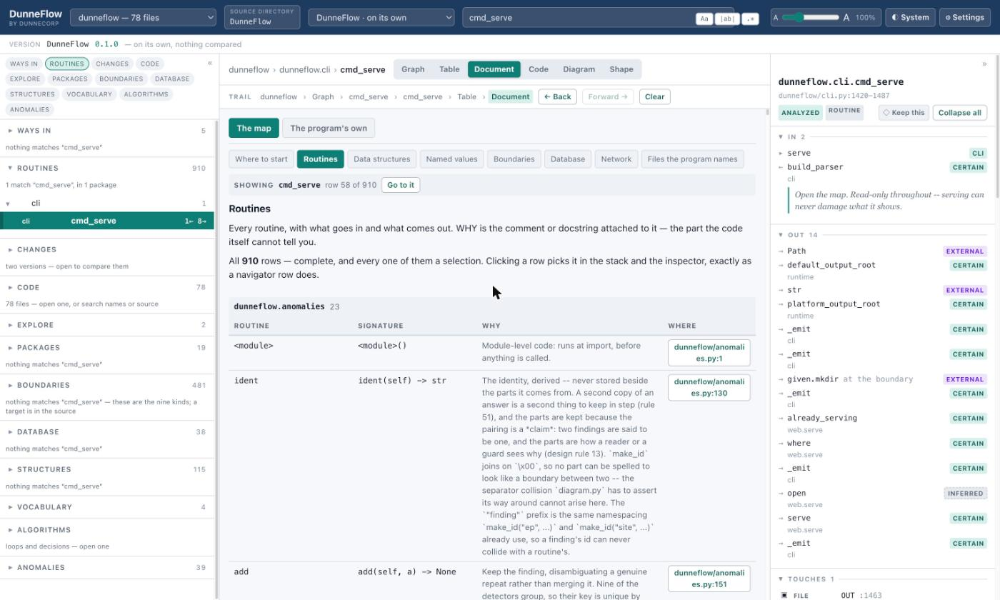
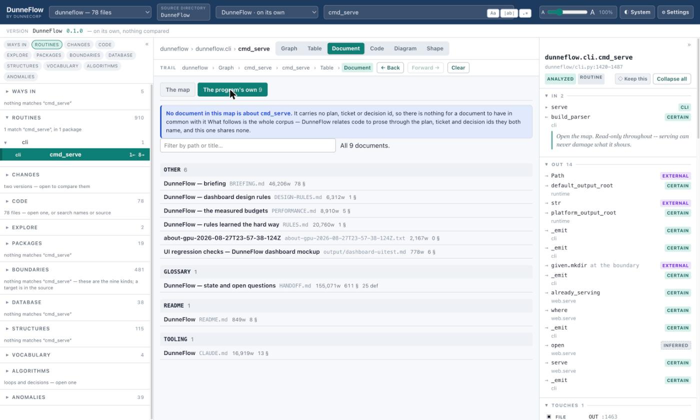
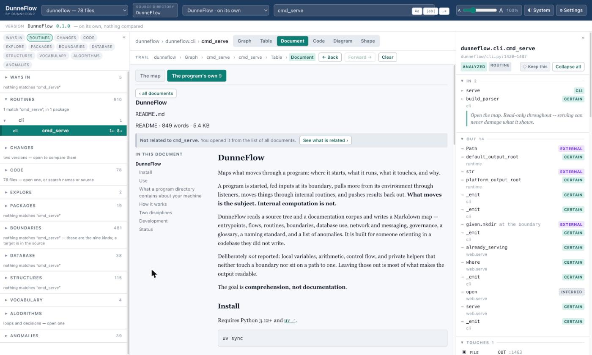

# 8. Document

Two lanes sharing one pane, and they are two different subjects rather than two views of
one thing.

- **The map** The eight documents DunneFlow *writes* about your program.
- **The program's own** Every document your program already *carries*.

The switch at the top picks between them, and it remembers which you were in.

## Lane 1: the map

Eight documents, generated from the graph:

| | |
|---|---|
| **Where to start** | Every way into the program, ranked by how much of it each one commands. |
| **Routines** | Every routine, with what goes in and what comes out, and what its author said. |
| **Data structures** | Classes, dataclasses, enums, type aliases. |
| **Named values** | The constants, and what they are. |
| **Boundaries** | Everything that leaves the program, by kind. |
| **Database** | Every table, its schema where the code states one, and who reads and writes it. |
| **Network** | What it calls out to. |
| **Files the program names** | Paths the code mentions. |

These read as documents, but every row is a **selection**. Click one and the stack lights,
the inspector fills, the trail records the hop, and Back will bring you home. A row naming
a database table selects the table, which means selecting all the code that reads and
writes it.

Like the table, it says where you are: *SHOWING `cmd_serve` — row 58 of 910*, with **Go
to it**.

Every analysis also writes the map to disk as Markdown, in `map@<instant>/`, so you can
send someone the answer without sending them the application. That directory holds
**fourteen documents and an index** including these eight, and seven more that have their own
surfaces in the dashboard rather than a tab here: flows, governance, anomalies, the
glossary, naming, traceability and the mirror.

## Lane 2: the program's own

Everything DunneFlow found beside the code encompassing Markdown, reStructuredText, and plain text, all
grouped by what kind of document it is, with its size in words and sections.

The filter box narrows by path or title. It hides rows rather than rebuilding the list,
which is why you can keep typing without the box losing focus under you.

The blue note at the top is worth reading. When nothing in the corpus is about your
current selection it says so, and says *why*:

> No document in this map is about `cmd_serve`. It carries no plan, ticket or decision
> id, so there is nothing for a document to have in common with it.

DunneFlow relates code to prose through the plan, ticket and decision ids they both name,
though never by matching words, which could produce confident nonsense at scale.

## Reading one

**IN THIS DOCUMENT** is the outline; click a heading to jump. Headings land at exactly the
line the document store recorded, which is what makes a glossary citation able to open on
the sentence that proves it.

A few deliberate choices about how a document is rendered:

- **No image is ever fetched.** An `` fires a network request with no click and no
  consent, out of a tool whose whole posture is that nothing leaves your machine.
- **A relative link is checked against the corpus before it is followed.** Many point
  outside the scanned tree. If it cannot be followed you are told, rather than navigated
  somewhere blank.
- **Raw HTML is not rendered.** That is the entire cross-site-scripting answer.
- **Author comments are folded by default.** HTML comments, particularly the ones whoever wrote the
  document deliberately hid, are counted and can be shown, but they are not body prose.
  On a large corpus there are thousands of them.

## Following a citation back

A glossary term that quotes your documentation offers **Read it in the document →**,
which opens the document at the line the definition is on. The pane above it shows the
bytes *as measured*, Markdown syntax and all. That is what proves the citation and the
link is how you see the sentence as it was meant to be read.

That button is drawn only where the captured corpus can actually serve the version on
screen. It is a statement of capability, never a hope.

---

Next: [9. Code](09-code.md)
