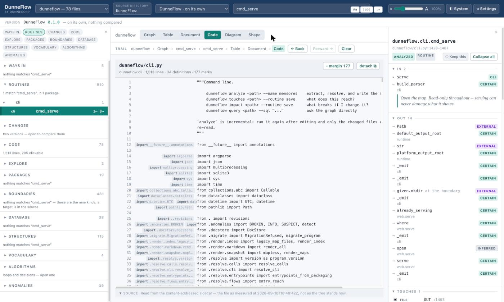

# 9. Code

The source, as it was measured.

## Where the text comes from

The line at the foot reveals the origin:

> **SOURCE** — Read from the content-addressed sidecar — the file as measured at
> 2026-09-10T18:48:42Z, not as the tree stands now.

DunneFlow keeps the bytes it read, held by content hash. That is not a cache. It is what
lets you open a sealed snapshot months later, on a machine that has never held the tree,
and read the code that the map is actually about. If you edit the file on disk, this pane
does not change, because everything else on the screen is a
measurement of the old bytes.

## Links are lookups, not guesses

A name in the source that is underlined is a **link to the routine the resolver actually
resolved it to**, from the graph. It is not a text match on the name. Click it and you
select that routine, everywhere.

Where a call cannot be pinned to a column (because the same expression occurs more than
once on the line) the link goes to the margin instead of underlining a guess. DunneFlow
records that a call happened on a line; it does not record *where* on the line, and
inventing a position would be inventing a fact.

## The margin

The narrow column on the left carries what the line does that the line does not say:
which import it resolves through, which boundary it touches. The header counts them
(*177 marks*) and **▾ margin** folds the whole column away when you would rather just
read the code. The button carries the count, because *fold the margin* and *fold the
margin holding 177 things* are different offers.

**detach** opens the file in its own window, which is what you want when you are reading
code and driving the graph at the same time.

## Searching the text

The Code group in the navigator has its own search box, and it is a **different question**
from the one in the top bar. That one searches names and meanings. This one searches the
text: a word inside a comment, inside a string literal, on a line that is neither.

It answers files first, reading every file with a count on each, never truncated, and only
fetches one file's lines when you open it. A broad word touches most of the program, and
finding every line in every file up front would be ten queries a file for an answer you
did not ask for.

Each hit says where it sits, including which routine and which class, resolved from the line range with
innermost first.

## When you are comparing

With a compared version set, the difference is drawn over the lines:

The line-level difference is what `git diff` gives you and gives you better. The half
above it is the one nothing else can: **which routines behave differently, and in what
respect,** what they call, what they touch, what they take or return.

The overlay has its own switch, because a file with four hundred marked lines is a file
whose *code* is harder to read than it was. See [comparing two
versions](14-comparing-two-versions.md).

---

Next: [10. Diagram](10-diagram.md)
