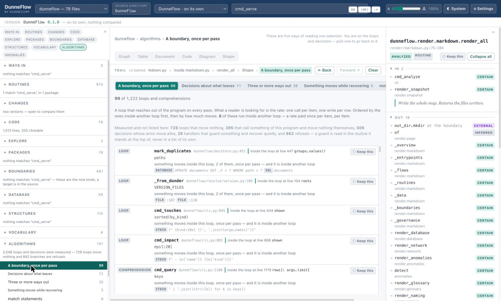

# 11. Shape

Every other view answers what a routine is *connected to*. This one answers what it
**does**.

## Why this exists at all

DunneFlow's founding rule is that **what moves is the subject and internal computation is
not**. Local variables, arithmetic and private helpers that touch nothing are deliberately
left out, and leaving them out is most of what makes the rest readable. There are many existing
tools to examine source code, follow live code values as the program executes, and debug
live applications with the values of variables available for inspection. DunneFlow has none
of these features. DunneFlow is entirely about connections and flow, and a different way of
looking at applications.

Control flow was on that list until it was amended, and the amendment is narrow:

> A loop or a decision is a subject **only where something moves inside it.**

A loop that increments a counter is the internal computation nobody asked for. A loop that
issues one network call per item is a **rate**, and a rate is flow. A branch whose arms
compute different numbers is arithmetic; one where an arm writes to a table and another
does not is a decision about what leaves the program.

## Reading the ribbon

It is a nested outline, and there are **no arrows** deliberately. Structured code has no
`goto` to draw, so there is no control-flow graph here, no layout pass and no library.
Boxes nested as the code is nested is the whole drawing.

Each line carries its line number, the kind, the header **as written**, and a note saying
what DunneFlow judged about it:

| | |
|---|---|
| `LOOP` | with its iterable as written, and *"something moves inside this loop, 2 of them, once per pass"* |
| `DECISION` | with its test as written, and whether every way out of it moves the same things |
| `GUARD` | a refusal — *"a precondition: it skips the pass, and a refusal is read in the routine, not in a worklist"* — and how it leaves (`→ continue`) |
| `HANDLER` | a `try`, and whether anything moves while recovering |
| `DATABASE` / `FILE` / `STDIO` … | something actually leaving the program, with the operation |
| `→ name` | a call, clickable |

**Nothing is dropped for being quiet.** A loop that moves nothing is still drawn, and says
*"nothing that moves happens inside it"*. It is the loops that move nothing that make the
ones that do credible.

Anything that names a table is a link: click it and you select the table, which selects
everything that reads and writes it.

## The Algorithms page

The mode toggle's **Shape** is one routine. The navigator's **Algorithms** group is the
same facts over the whole program, in five lanes.

| Lane | What is in it |
|---|---|
| **A boundary, once per pass** | Loops that reach out of the program every time round. One call per item, one write per row — the rate. |
| **Decisions about what leaves** | Branches whose arms differ in what they move, not in what they compute. |
| **Three or more ways out** | Ladders. |
| **Something moves while recovering** | Handlers that do more than swallow. |
| **`match` statements** | Counted whether or not there are any. |

Two things about this page:

**Every lane states its denominator.** *99 of 1,222 loops and comprehensions* — never
*99 loops*, which would be a number you could not weigh.

**The quiet bands are stated above the list**, and that is the honest half:

> Measured and not listed here: 728 loops that move nothing, 395 that call something of
> this program and move nothing themselves, 509 decisions whose arms move alike, 28
> handlers that guard something and recover quietly, and 662 refusals.

Four lanes holding a few hundred points is a claim about the several thousand that are not
in them, and this is where that claim is made.

## What it cannot see

Two things worth knowing, both stated on screen where they apply.

**A decision is compared by its header as written.** `x == 1` and `x==1` are two different
values here. That is a blind spot rather than a bug. DunneFlow records what the source
says, and normalising it would be inventing an equivalence the source does not state.

**A span cannot tell what a loop is over from what it does.** What is recorded is the
loop's iterable or its test, never the word that opened it. This means a loop is labelled `LOOP`
and not `for`, because `for` would be a guess and `while True` would sometimes be a false
one.

---

Next: [12. Chasing rabbits](12-chasing-rabbits.md)
