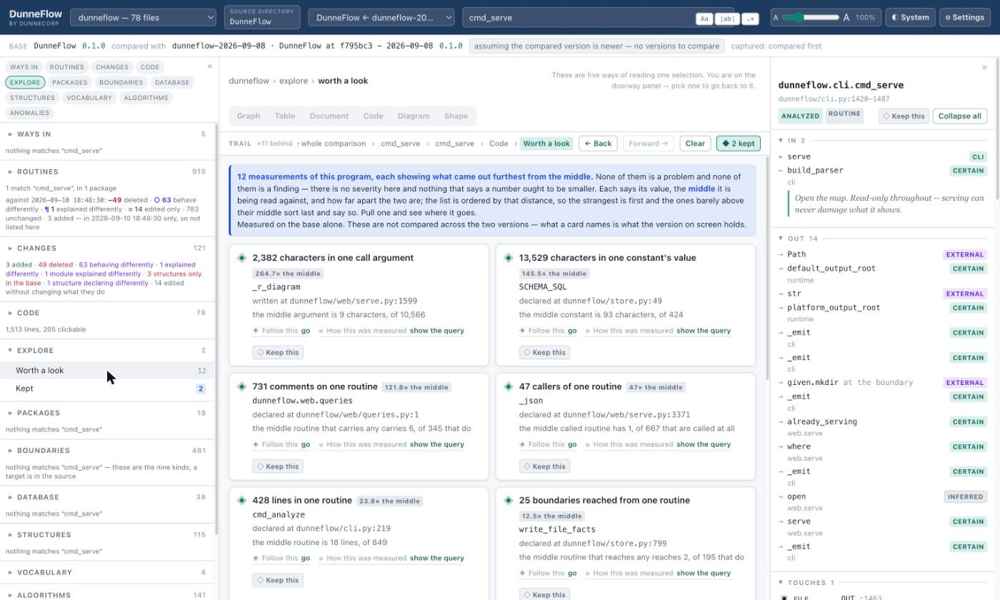
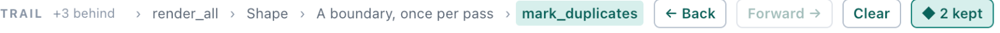

# 12. Chasing rabbits

Orienting in an unfamiliar codebase is not a search. You start with one question, notice
something odd on the way, follow it, notice something else, and twenty minutes later you
have learned five useful things and cannot remember what you were originally doing.

DunneFlow is built for that, rather than against it. Three things make wandering safe:
**threads** give you somewhere worth going, the **trail** brings you back, and **keeping**
means a detour costs you nothing.

## Threads to pull

At the bottom of the inspector, for whatever is selected.

This is **adjacency by interest, not by edge**. Two routines that never call each other and
both write to one table are coupled, and no call graph will ever tell you that.

| Lane | Why it is worth a detour |
|---|---|
| **The other end** | You write this table; here is who reads it. |
| **Runs the same shape** | You loop over this table; two other routines do too. They never call each other. |
| **Named like these** | Your name follows a convention ninety-eight other things follow — or, as often, your name is a word nothing in this program defines. |
| **Shares a plan** | The same ticket, plan or decision id. |
| **Unusual nearby** | The most commented routine on your plate. The one called from the most places. A value read three times as often as it is written. |

Every thread states **its own size**, so you can weigh it. A lane that fires on 8 routines
out of 4,823 says so rather than looking like a general truth.

## Worth a look

The **Explore → Worth a look** panel is the same idea with no selection required — a
doorway when you do not yet know what to ask.

Twelve measured extrema, each with **its middle stated beside it**. Every program has a
most-commented routine, so a maximum on its own is a claim nobody can weigh. *2,382
characters in one call argument, 264.7× the middle* is a discovery. *3 levels of nesting
against a middle of 2* is not, and the panel says the second as plainly as the first.

**A curiosity is a measurement, never a judgement.** No severity, no blind spot, nothing
implying a number ought to be smaller. That is what the anomaly worklist is for, and these
are deliberately not that.

**show the query** gives you the SQL that produced the number — and it is the query that
returned the whole card, middle and population included, not a query about the number
alone. Run it yourself with `dunneflow query`.

## The trail

Every selection you make is recorded, and the bar across the top of the centre pane is
your route.

**← Back** (`⌘Z`) and **Forward →** (`⇧⌘Z`) step along it. They work from anywhere — the
person who needs Back is by definition lost and should not have to find a particular pane
first.

**Every step carries what it *is*, not just what it is called.** Two different things can
print the same name — on a real codebase, 531 routines share a module word and every
package has an `__init__` — so a trail that stored labels would take you back to the wrong
one, confidently.

**The bar is a window onto the history, not the history itself.** It shows a dozen steps;
Back reaches further. What falls off either end is stated — *+3 behind*, *+8 ahead* —
because a trail that silently forgets is worse than a short one: you would have no way to
know Back could still take you further.

**Forward is a real branch.** Step back three times and the steps ahead of you are still
there, drawn differently from the past, until you select something new.

**Clear** drops the trail. It does not drop what you have kept.

## ◇ Keep this

Anywhere you see **◇ Keep this** — the inspector, a thread, a curiosity, a search hit, a
row on the Algorithms page — that thing lands on a shelf.

The count sits in the trail bar as **◆ 2 kept** and opens the shelf. Every row **opens**
— click it and you go back to the thing itself, not to a note about it. **Drop** removes
one.

This is the whole point of the feature, and it was once broken in exactly the way that
matters: a kept thing that shows you a row and cannot take you back to it is a bookmark to
nowhere.

### Kept things have different lifetimes, and the shelf says so

- **A routine, a constant, a structure** survives anything above it moving. It is
  identified by its qualified name, not its position, so inserting fifty lines above it
  changes nothing.
- **A word your program states** — a ticket id, a table name, a naming pattern — survives
  re-analysis entirely and means the same thing at both ends of a comparison. Nothing in
  the map minted it. Its row also recounts itself: *how many routines this stands for
  now*, not how many it stood for when you kept it.
- **A line, or a loop at a line**, is only true of the version it was kept in. If you
  switch to a different version the row says so: *kept at 2026-09-08, so this version may
  have moved it*.
- **A box in a diagram** belongs to the drawing it was drawn in, and is valid at the
  altitude you drew it at. The row says that too.

## A worked detour

1. You are reading `cmd_serve` because you want to know how the server starts.
2. Its inspector shows **Threads to pull → The other end: `documents` — you write and read
   it · of 20 others, 16 read it and 3 write it.** You had no idea twenty other things
   touched that table.
3. You follow it. The table's page shows what loops over it, and one of those loops runs a
   `DATABASE UPDATE` once per row.
4. That is interesting but it is not what you came for. **◇ Keep this** on the loop.
5. **← Back**, twice. You are on `cmd_serve` again, on the line you left.
6. When you are done, **◆ 1 kept** takes you straight to the loop.

The detour cost you nothing, which is the only reason it was safe to take.

---

Next: [13. Settings](13-settings.md)
