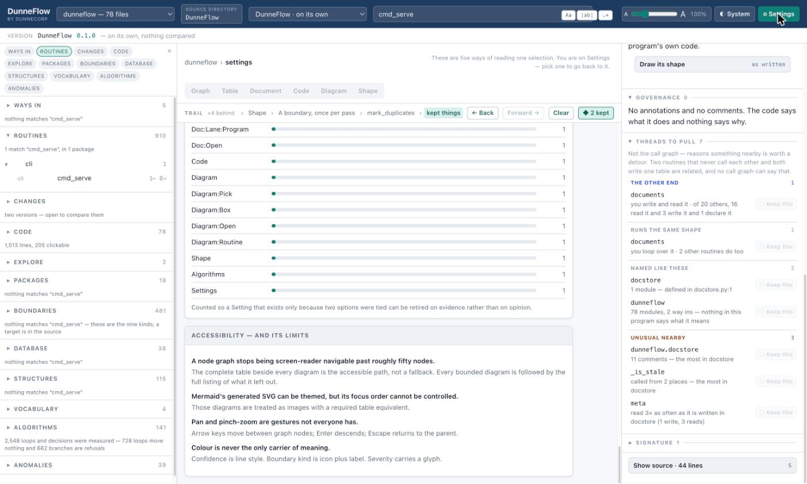

# 13. Settings

**⚙ Settings** in the top bar. Everything here is stored in your browser and stays on your
machine — a view someone sends you keeps their layout; this stays yours.

## Appearance

**Theme** — Light, System or Dark. Both themes are designed, not inverted.

**Interface scale** — one multiplier over everything: type, column widths, row heights,
icons, and the nodes in the graph. Every dimension in DunneFlow is stored in `rem` for
exactly this reason, so nothing is left behind when you move it.

## Colour

Colour separates one meaning from another in two places, and only two: **a difference** —
what only one version has — and **severity** in the anomaly worklist.

Three sets are offered, each with a light and a dark variant:

| | |
|---|---|
| **Red and green** | What the dashboard has always used. Familiar, and the weakest of the three when red and green cannot be told apart — the numbers below say by how much. |
| **Blue and orange** | Built to stay separable when red and green do not: Okabe-Ito's vermillion and blue for a difference, a red-to-magenta-to-blue ramp for severity. Named for the colours rather than for the reader, because the colours are the fact and the rest is the claim underneath. |
| **Muted** | The same hues as the default, at lower chroma, for a reader who finds it loud. **Quieter is not safer** — it is the same red and the same green, so it measures where they measure. |

Each set states **two** numbers, and they answer different questions:

- **Contrast** (`5.34:1`) — whether a colour can be *read*. 4.5:1 is the minimum for body
  text.
- **Separation** (`ΔE 5`) — whether two colours can be told *apart*, taken as the worst
  case across normal vision, deuteranopia and protanopia.

A set can pass the first and fail the second, which is why both are printed. Where two
colours are close, the page says so: *"these two are hard to tell apart without the words
beside them."*

Colour is never the only carrier of meaning anywhere in DunneFlow. Confidence is line
style. A boundary kind is an icon plus a label. Severity carries a glyph.

## The graph

Everything on the graph HUD is here too, plus a few that live only here. See
[Graph](06-graph.md) for what each does — spacing, the three spread axes, plate width,
node sizing, plate layout, plate order, the pointer and its colour, the reticule, and
whether links stay drawn while the camera turns.

The pointer colour is **clamped**: below 3:1 against the graph's own background it is
refused, and the refusal says why. 3:1 rather than 4.5:1 because it is a large graphic
object rather than body text.

## What opens, and what shows

Which panes are open, how many navigator groups may stand open at once, how many routines
a package lists before the rest are left to the table, whether the trail bar is shown and
how many steps it shows, row density, and whether the cover's ranked lists draw a
proportion bar beside their counts.

Two worth calling out:

**Navigator groups: one at a time, or all of them.** One is the default because the
alternative was measured and it hurt: scrolling into a four-thousand-row Routines list put
every menu below it two hundred rows out of reach.

**Routines listed per package.** 200 by default, `0` for all of them. Your machine and
your patience are yours to spend.

## The three comparison overlays

Three separate switches, and they are separate because what each costs is different. None
of them is drawn at all when there is only one version — a switch that governs nothing is
worse than no switch.

| | What it costs |
|---|---|
| **The code overlay** | A per-file difference and up to a few hundred marked lines. The dearest to read, because it makes the *code* harder to read. |
| **The routine and table marks** | Free — drawn from an answer already held. |
| **The findings overlay** | The dearest to compute: thirteen detectors run against a graph this process has never opened. 1.3 to 4.1 seconds the first time, nothing afterwards. Fetched when you open the worklist, not at boot. |

Wanting the free ones while reading clean code is an ordinary thing to want, and one
switch could not express it.

## Usage

A count of which views you actually open. It is here for one reason, stated on the page:
several settings exist only because two options were genuinely tied, and this is how the
loser gets retired on evidence rather than on opinion. It is local, like everything else
here.

## Accessibility — and its limits

Documented in the product rather than apologised for:

- **A node graph stops being screen-reader navigable past roughly fifty nodes.** The
  complete table beside every diagram is the accessible path, not a fallback.
- **Generated SVG can be themed, but its focus order cannot be controlled.** Those
  diagrams are treated as images with a required table equivalent.
- **Pan and pinch-zoom are gestures not everyone has.** Arrow keys move between graph
  nodes; Enter descends; Escape returns to the parent.
- **Colour is never the only carrier of meaning.**

## Resetting

The reset lists what it is about to clear, in the words you would recognise them by. It
never names a setting you were not offered — a default is a promise that something can be
different.

---

Next: [14. Comparing two versions](14-comparing-two-versions.md)
