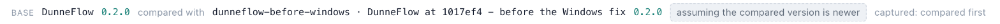

# 2. The cover

The map opens on the cover. It is the answer to *what is this program*, in three panels,
before you have asked anything specific.

![The DunneFlow dashboard showing the dunneflow map. The heading reads "dunneflow 142 files · 53,939 lines · 1,550 routines · analysed 2026-10-02 19:59 UTC". WHERE TO START ranks dunneflow, tagged CLI and DECLARED, at 488 with the line "pyproject.toml [project.scripts] dunneflow = dunneflow.cli:main"; then serve at 71 (web/serve.py:4182) and another serve at 57 (mcp/server.py:325), both MAIN and GUESSED; run at 17; _Handler.do_GET at 4 and _Handler.do_POST at 2, tagged HTTP_ROUTE and GUESSED; and a second run at 2. Every bar after the first is short. WHAT IT TOUCHES totals 526: DATABASE 290, FILE 154, STDIO 62, PROCESS 9, ENV 5, CRYPTO 3, NETWORK 3. WHAT LOOKS WRONG shows Broken 0, Suspect 26, Informational 18. The navigator on the left lists WAYS IN 7 and ROUTINES 1,550 "in 24 packages", with web 352, extractors 296, resolve 199, plugins 126 and render 103 at the top; the inspector is folded to its rail on the right](images/02-the-cover.jpg)

## The heading

> **dunneflow** 142 files · 53,939 lines · 1,550 routines · analysed 2026-10-02 19:59 UTC

The date is not decoration, it's a label. A map is a reading of a tree at a moment, and it
keeps saying which moment for as long as it exists. Later, when the source has moved on, 
this line is how you know what you are looking at.

## Where to start

> ranked by how much of the program each one commands

Seven ways in, and the first one — `dunneflow` itself, the command you type — commands
488 of the 1,550 routines. The two `serve`s command 71 and 57 — the dashboard's server and
the agent's — and `run` 17. Then the drop is steep: 4, 2, 2.

That shape is the useful part. It says DunneFlow is a command-line program with one large
front door and two servers hanging off the side of it — which is true, and which you now
know without having opened a file. DunneFlow is about the flow of information, in this
case it is the flow of information into the program.

Each entry says how it was found, and the first two say it differently. `dunneflow` carries
**CLI** and **DECLARED**: the tag is the kind of way in, and *declared* means DunneFlow read
a sentence that said so — the line under it, `pyproject.toml [project.scripts] dunneflow =
dunneflow.cli:main`, is the package's own manifest naming its command. `serve` carries
**MAIN** and **GUESSED**: nothing declared it, and DunneFlow inferred it from a
conventional name at module level. The tool is persistently willing to tell you how
confident it is, and this is the first place you see it.

Notice that code editors do not guess, but that DunneFlow will do so. DunneFlow is not
the same kind of tool that exists already, it is intended to be different. It follows the
rabbits wherever they may lead, and sometimes guessing can help make the intellectual
leap needed to connect two concepts that have no obvious link. That sort of connection
can help to create that insight moment and forms a foundation on which to build lasting knowledge.

**Two of the seven are HTTP routes** — `_Handler.do_GET` and `_Handler.do_POST`. They
command 4 and 2 routines respectively, which is a good demonstration of what "commands"
means: those two dispatch to fifty-odd routes, but they *reach* almost nothing directly.
Reach is measured, not asserted.

## What it touches

> 526

This is the panel that says what kind of program you have, and it is the one to read first
on a codebase you have never before seen. If the application was written by an AI, it is
possible that no one has ever seen the source code.

| | | |
|---|---|---|
| DATABASE | 290 | It is mostly a database program. |
| FILE | 154 | It reads and writes a lot of files. |
| STDIO | 62 | It talks to a terminal. |
| PROCESS | 9 | It starts other programs — nine places. |
| ENV | 5 | It reads five things from the environment. |
| CRYPTO | 3 | Hashing, here; it is how the caches are keyed. |
| NETWORK | 3 | Three. For a tool with a web dashboard. |

That last row is the interesting one and it is worth dwelling on, because it is the 
reason for this panel. **Three network touches, in a program that serves a
dashboard.** Open **BOUNDARIES** in the navigator, click **NETWORK**, and the stack lights
what is behind the number:

![The graph after clicking NETWORK under BOUNDARIES. The trail reads "dunneflow › NETWORK › NETWORK f'{url}api/programs'". The heads-up panel says "60 fps · 2,690 nodes · 25 plates" and "on ext:<small outside>, pkg:web · f'{url}api/programs', (NETWORK, unnamed) · 4 nodes · 0 within · 2 crossing · 2,686 dimmed · focus: only what is lit answers", with the sliders open beneath it; the stack is grey but for a few lit nodes and the links between them, and the Plates panel is folded to its rail. The navigator's BOUNDARIES group is open at "7 kinds": DATABASE 290, FILE 154, STDIO 62, PROCESS 9, ENV 5, CRYPTO 3, NETWORK 3. The inspector on the right is headed f'{url}api/programs', tagged ANALYSED and BOUNDARY: IN 1, already_serving from web.serve, INFERRED; OUT 0, "It calls nothing this map can see."; TOUCHES 0; and REACHED FROM INSIDE, "not reached from inside any loop. Listed below with 1 other enclosing span — a decision that writes is a fact about this, even though it is not a rate", above the row already_serving HANDLER 3744; then GOVERNANCE 0 and THREADS TO PULL 0](images/02-network.jpg)

Two boundary nodes and the two routines that reach them. The three touches are:

| | |
|---|---|
| `_free_port` | `serve.py:3764` and `:3770` — binding a socket to find a port that is free; the address is built at run time, so this end has no name |
| `already_serving` | `serve.py:3745` — asking `f'{url}api/programs'` whether a server is already up |

All three are localhost, and there is no fourth. DunneFlow's claim that nothing leaves your
machine is not a promise in a README here; it is a number on the cover of its own map, with
the three rows under it. If a model were being called, or a package index consulted, or a
crash reported home, this row would say so — and it is the shortest row on the panel.

## What looks wrong

> every finding states its blind spot

| | |
|---|---|
| Broken | 0 |
| Suspect | 26 |
| Informational | 18 |

And underneath, the sentence that governs the entire feature:

> Severity says what it would mean for the program. Confidence says how sure DunneFlow is.
> They are different questions.

Blurring those two is the standard failure of many tools that report problems, and it is
why most of them get ignored. *This is probably fine but would be catastrophic* and *this
is definitely happening and barely matters* are not the same row, and DunneFlow will not
let them be.

Every finding also carries a **blind spot** — what would make it a false alarm. That rule
exists because on the first run against a live codebase, six confident findings in a row
turned out to be defects in DunneFlow rather than in the program it was reading. Yes, those
problems were fixed, so anything that is wrong with DunneFlow now is a new problem.

## The navigator

Down the left: **WAYS IN 7**, **ROUTINES 1,550 in 24 packages**, and below them CHANGES,
CODE, EXPLORE, PACKAGES, BOUNDARIES, DATABASE, STRUCTURES, VOCABULARY, ALGORITHMS,
ANOMALIES.

The package list is ranked by size — `web` 352, `extractors` 296, `resolve` 199, `plugins`
126, `render` 103 — and runs all the way down: the five smallest, `macapp` 4, `canonical` 3,
`lookup` 2, `standards` 2 and `words` 2, carry a `·small` mark, because they are too small for a plate
of their own and the stack draws them together. Marked, and **still listed**, with their
counts. Nothing is dropped for being small; it is just moved out of the way of the things
that are not.

## The strip above it

This map holds three readings of DunneFlow: the current source, and two snapshots sealed
from earlier commits — one from before a fix for Windows landed, which is the one the strip
is holding it against, and one from further back. That is [chapter 8](08-two-versions.md)'s
subject and you can ignore it for now — including the button that says which way round it
is assuming the two go — but it is worth knowing it is there, because several panels behave
differently once a comparison exists, and they will tell you so rather than changing
quietly.

---

Next: [3. One selection, six ways](03-one-selection-six-ways.md)
