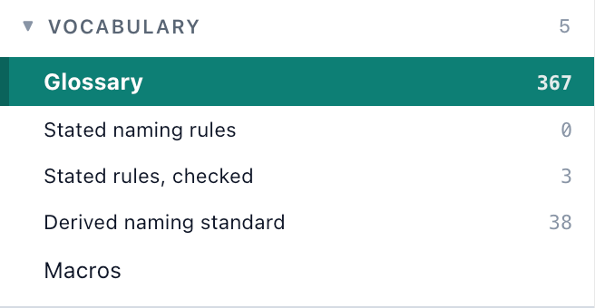

# 10. Words and names

Open **VOCABULARY** in the navigator. There are five rows:



| | |
|---|---|
| Glossary | 367 |
| Stated naming rules | 0 |
| Stated rules, checked | 3 |
| Derived naming standard | 38 |
| Macros | |

The last row is for what C and C++ macros write, and the reference guide covers it. The
other four are two questions, and they are not the same one. *What do this program's words mean* is the
glossary. *How are its names spelled* is the other three, which look like one question and
are three — what the code does, what somebody wrote down, and whether they agree.

## The glossary

![The glossary page. Four provenance tiers are listed at the top: DECLARED · code "quoted from a docstring in this program", DECLARED · docs "quoted from the project's own documents — none here", CITED "a model found it in prose and cited the line — checkable — none here", INFERRED "nothing in the project explains it; this is a guess — none here". A highlighted paragraph reads "89 of the 367 words this program uses as names are defined somewhere it can quote. 2 definitions were found across 55 distinct documents — a byte-identical copy is read once — and every one of them names the file and the line it came from. The 278 the program does not define are listed below rather than left out: a word carried by fifty constants and explained nowhere is a finding. A further 207 are held back at the foot of this page — they occur only inside a compound constant name — and any of them can be put in the worklist. Every citation here opens — in the bytes this map measured, not the tree as it stands now." Below, a filter box reading "Filter 367 words…" and "89 defined and 278 undefined — nothing hidden", then the entry for calls — 11 constants, 4 modules, 2 tables — with DECLARED · code definitions: "Call sites, their arguments as written, and the boundaries the rules recognise." from kotlin/calls.py:1, "Turning call expressions into edges — the driver." from resolve/calls.py:1, "Which definition a Python call expression meant." from python/calls.py:1, and "Which definition a TypeScript call meant: `resolve/supplied.py`, asked for TypeScript." from typescript/calls.py:1, each with a show me button](images/10-glossary.jpg)

DunneFlow mines the words this program uses as *names* — packages, classes, tables, ways
in, constants — and then goes looking for somewhere they are defined. On itself:

> **89 of the 367 words this program uses as names are defined somewhere it can quote.**

The four tiers at the top are the whole provenance system in one block, and on this map
three of them say **none here**:

| | |
|---|---|
| DECLARED · code | quoted from a docstring in this program |
| DECLARED · docs | quoted from the project's own documents — **none here** |
| CITED | a model found it in prose and cited the line — checkable — **none here** |
| INFERRED | nothing in the project explains it; this is a guess — **none here** |

The lower two tiers exist, are declared, and are empty — and stay empty, because nothing
on the analysis path calls a model. That is not a placeholder waiting to be filled in.
It is the shape of the promise: *if* inference ever happens, it will arrive in a tier of
its own and be labelled, rather than mixed in with the quotations.

The empty **DECLARED · docs** tier is a different kind of empty, and an honest one. The
documents *were* read — two definitions were found across them — but neither defines a
word the program uses as a name, so every one of the 89 definitions on this page is a
docstring quoted out of the code. ([Chapter 13](13-the-command-line.md)'s `mirror` says
what became of the two.) And it counts the documents honestly: 55 *distinct* ones, because
one of the 56 files is a byte-identical copy of another, and a copy is read once.

Every definition carries a file and a line, and a **show me** button that opens the
bytes — out of the copy captured when the map was made, not out of the tree as it stands
today. That distinction matters the first time you read a map of a version you no longer
have checked out.

### The 278 and the 207

Two numbers on that page are about things DunneFlow *could not* do, and both are printed
rather than quietly dropped.

**278 undefined** words are listed with the rest. A word carried by fifty constants and
explained nowhere is a finding, not a gap in the report.

**207 held back** is subtler and worth understanding, because it is the difference
between a useful worklist and a useless one. A constant's name is split on underscores,
so `_GLOSSARY_DEFINITION_MAX_LEN` contributes `glossary`, `definition`, `max` and `len` —
and three of those four are the name's type and its unit, not the program's vocabulary.
Any word that is *only ever* a fragment inside a constant's name, and that nothing
defines, is set aside at the foot of the page with the reason. It is one click to put any
of them back.

The held-back list opens with `ROUTINE`, `CURIO`, `HOVER` and `BOUNDARY` — out of names
like `CODE_FILE_ROUTINE_COUNTS`, `CURIO_ARGUMENT`, `HOVER_ANNOTATIONS` and `BOUNDARY_NODES`.
Without the rule, words like those would sit in the undefined list between the ones
actually worth defining.

## What the code does with names

Click **Derived naming standard**.

![The derived naming standard page. Three highlighted notes: "This standard was derived from the code, not required of it. Every convention below was found by counting what the program actually does. None of it was imposed by anyone, and none of it is measured against a standard your team wrote — that is stated rules, checked, and it measures a rule somebody stated rather than a convention found here. So a convention holding 100% of the time means the code is consistent, not that it is correct.", followed by "A leading underscore is counted as a violation here, which is the strict reading. Settings can allow it as a privacy mark."; "Somebody may also have written naming rules down. Those are quoted rather than counted, and they live on their own page so that neither can be mistaken for the other. Neither page compares them", with a link reading "Stated naming rules — 0 read from your documents"; and "Every figure here is counted, not guessed. The exceptions are the point." Below, a section headed HOW NAMES ARE SPELLED · 28 with the line "Measured per row rather than per distinct name", and the first convention: "Python routines", graded B, "Python routines are named in snake_case.", a bar reading 1,286 of 1,303, and a list headed 17 EXCEPTIONS beginning do_GET web/serve.py:3891 and do_POST web/serve.py:3918](images/10-derived.jpg)

Thirty-eight conventions, each with a grade, a count and every exception named. The
command line prints the first fifteen and says where the rest are:

```
[B] 1,286/1,303  Python routines are named in snake_case.  (17 exceptions)
[B] 615/622  Python routines marked private are called only from their own module.  (7 exceptions)
[B] 484/486  Python parameters are named in snake_case.  (2 exceptions)
[E] 249/281  Java routines are named in camelCase.  (32 exceptions)
[B] 273/276  Python database tables are named in snake_case.  (3 exceptions)
[C] 239/245  C and C++ routines are named in snake_case.  (6 exceptions)
[A] 233/233  Rust routines are named in snake_case.
[D] 180/199  Python classes are named in PascalCase.  (19 exceptions)
[D] 161/172  Python data structures are named in PascalCase.  (11 exceptions)
[A] 148/148  Java parameters are named in camelCase.
[A] 128/128  Python modules are named in snake_case.
[A] 124/124  TypeScript routines are named in camelCase.
[C] 119/123  Go routines are named in camelCase.  (4 exceptions)
[A] 119/119  Go routines marked private are called only from their own package.
[A] 118/118  Rust parameters are named in snake_case.
... 23 more; all of them in 11-naming.md
GAP  Go classes: 47 counted — PascalCase 35, camelCase 12
GAP  Go data structures: 60 counted — PascalCase 47, camelCase 13
GAP  Java modules: 11 counted — other 11
NOT MEASURED  C and C++ privacy: a class's private member is private to the class, whose members are routinely defined in another file
NOT MEASURED  Java privacy: `protected` and package-private are recorded as private beside `private` itself, and both are visible beyond the file
NOT MEASURED  Rust privacy: `pub(crate)` and `pub(super)` are recorded as private beside true module privacy, so a call from another module is often correct code
```

**The exceptions are the point**, and the page says so. Seventeen Python routines are not
`snake_case`, and reading them tells you something no percentage could: `do_GET`,
`do_POST`, and fifteen `visit_ClassDef`-shaped names. Those are not sloppiness. They are
two protocols — `http.server` wants `do_GET`, `ast.NodeVisitor` wants `visit_ClassDef` —
and the spelling is not this program's to choose.

That is the whole argument for grading rather than scoring. A convention that holds every
time tells you how to read the program; one that holds nearly every time tells you *where
to look*.

**The last six lines are not conventions, and they are printed for that reason.** A
**GAP** is a population with no dominant spelling — Go's classes are PascalCase 35 times
and camelCase 12 — and a reader who saw only the conventions would take the silence for
consistency. **NOT MEASURED** is a question the map declines to answer, with the reason
beside it: what *private* means in C++, Java and Rust is wider than one file or one module,
so a count of private routines called from outside would say something about the reader
and nothing about the code.

**Every spelling convention names a language.** DunneFlow's own source is in six, and
when it was only Python and TypeScript, *"routines are named in snake_case"*, measured over
both at once, used to come out a `D` — with every one of its exceptions a TypeScript name
spelled the way TypeScript spells names. One grade made of two answers that were each
nearly perfect. **A convention is a fact about a population**, and *"this program spells
names like this"* is not a question a mixed corpus can answer, so the population is split
by the one thing the map can actually be asked: what language each file is in. That is why
there are thirty-eight of them now and were sixteen then. The *affix* conventions on
routines (`cmd`, `replace`, `meta`) are deliberately **not** split: an affix is a word a
team chose rather than a way of spelling one, and a team that says `cmd` says it in every
language it writes.

And the note at the top is the other half:

> This standard was derived from the code, not required of it. … So a convention holding
> 100% of the time means the code is consistent, not that it is correct.

## What somebody wrote down

Click **Stated naming rules**. It says **0**.

![The stated naming rules page with no rules. The first note reads "These are quoted, not counted, and nothing on this page is measured. Every rule below was written by somebody and read out of a document with a file and a line you can open. Measuring one against this program is stated rules, checked; here a rule and a convention on the derived naming standard may contradict each other and neither page will say so." The second reads "56 documents were read (1 of them a byte-identical copy of another), and not one of them states a naming rule. That is a finding rather than an absence of one: the derived naming standard shows what the code does about names, and nothing in this project records what it was supposed to do. A rule has to name a class of identifier or a house word to be recognised here; a paragraph that merely discusses naming is deliberately not mined, because a research paper about naming standards once yielded ten confident rules that were not rules at all." A panel headed WHAT THE CODE ACTUALLY DOES, marked "the other lane", explains that this page is what your documents say and the derived naming standard is what the code was found to do, and links to the derived naming standard's 38 conventions](images/10-stated-none.jpg)

A zero is the most interesting thing on this page, because of how carefully it is
distinguished from two other zeros that look identical:

| | |
|---|---|
| no documentation was read at all | *we did not look* |
| documents were read and there were none | *there was nothing to look at* |
| **56 documents were read, and not one states a naming rule** | *we looked, and this is the answer* |

All three arrive at the browser as an empty list. Flattening them would turn *"we did not
look"* into *"there is nothing there"*, so the count travels beside the list and the page
picks its sentence from it.

And the answer is true. DunneFlow's own corpus is 56 documents, among them a file of more
than a hundred engineering rules, and not one of them is a naming rule. The detector will
not mine a paragraph that merely *discusses* naming — the note says why, and it is a
scar: a research paper *about* building a naming-standards importer once yielded ten
confident rules that were not rules at all.

## Whether they agree

Click **Stated rules, checked**. This is the page the other two keep pointing at.

![The stated rules, checked page. A note reads "This page is the comparison, and it is the only one that is. The stated naming rules quote what somebody wrote and count nothing; the derived naming standard counts what the code does and quotes nobody. Here each stated rule is measured over the population its own document says it governs — and a rule this map cannot answer says so rather than passing quietly.", then "A leading underscore is counted as a violation here, which is the strict reading. Settings can allow it as a privacy mark.", then "3 of 3 rules could be checked, finding 20 exceptions." Below, a section headed CHECKED · 3 with the line "Measured over the population the rule governs. Every exception is listed — the exceptions are the product." The first card reads "classes · PascalCase", tagged IMPORTED, sourced from naming.md:13, quoting "Classes: PascalCase", with a bar reading 180 of 199, the note "over classes — scoped by **/*.py, which the rule's own document declares", and 19 EXCEPTIONS beginning ClassDef_ schema.py:900, Exception_ resolve/naming.py:209, Field_ schema.py:238, _AppResolver resolve/cli.py:36, _AsyncCost anomalies.py:46, _Base web/serve.py:367, _Clock web/serve.py:557, _Extractor python/extract.py:176, _FieldPlan ingest/codec.py:92, _Handler web/serve.py:1565 and _Index python/calls.py:66](images/10-checked.jpg)

> 3 of 3 rules could be checked, finding 20 exceptions.

Where did three rules come from, when the last page said zero? From outside. This map was
built with a standards directory:

```bash
uv run dunneflow analyze src/dunneflow --name dunneflow --standards ../dunnecorp-standards
```

`--standards` reads somebody else's naming standard through the same document scan as
your own corpus, into a store of its own, and every rule it yields is tagged **IMPORTED**
and cites the document it came from — here `naming.md:13`.

Three things on this page are worth more than the numbers.

**The population is never inferred from the wording.** The rule says *Classes:
PascalCase*, and the card says what it measured that over: `over classes — scoped by
**/*.py, which the rule's own document declares`. A rule that named a population this map
cannot supply would say *no population here*, and one whose spelling cannot be tested —
a template like `NN-kebab-name` — would be quoted back and declared **not checkable**.
Three verdicts, never two, because collapsing any of them lets *"we could not check"*
read as *"it passes"*.

**Every exception is listed**, and the nineteen are the interesting part again. Sixteen
of them — `_Base`, `_Handler`, `_Live`, `_Scanner` and friends — are PascalCase with a
leading underscore, and `ClassDef_`, `Exception_`, `Field_` have a trailing one to avoid
colliding with a name they wrap. The other two rules account for the twentieth: one
constant, `Decision`, is not SCREAMING_SNAKE_CASE, and all 128 modules are snake_case.

**180 of 199.** You have seen that number before — it is exactly what the *derived* page
graded D for `Python classes are named in PascalCase`. The same population, the same count,
reached from two directions: one by asking the code what it does, the other by asking a
document what it requires and measuring it. They agree because they are measuring the same
thing, and the tool still keeps them on separate pages, because the day they disagree is
the day you need to know which one you are reading.

### Is `_Handler` PascalCase?

Strictly, no: it does not begin with a capital. It is also the commonest way a codebase
marks something private, and whether your standard meant to cover that is a question for
the standard, not for DunneFlow. So the answer is yours to choose, in **Settings**, on the
row **A leading underscore in a name**:

| | |
|---|---|
| **Counted as a violation** | the strict reading, and the default |
| **Allowed** | the underscore is read as a privacy mark, and the rest of the name is judged |

Both naming pages follow it, and each says in its opening note which reading is in force.
Choose **Allowed** and come back:

![The stated rules, checked page with the Setting changed. The note now reads "A leading underscore is allowed here — read as a privacy mark, not part of the spelling. Strictly it is a violation; Settings has the choice.", then "3 of 3 rules could be checked, finding 4 exceptions." The classes · PascalCase card, IMPORTED from naming.md:13, now reads 196 of 199, with 3 EXCEPTIONS: ClassDef_ schema.py:900, Exception_ resolve/naming.py:209 and Field_ schema.py:238, followed by "How this number was counted — show the query" and "Read the rule as it was written — go". The next card, constants · SCREAMING_SNAKE_CASE from naming.md:14, begins below](images/10-checked-allowed.jpg)

> 3 of 3 rules could be checked, finding 4 exceptions.

**196 of 199**, and the three left are the trailing underscores, which no reading of a
privacy mark excuses. The derived page moves with it: classes go to 196 of 199 and data
structures to 169 of 172, both graded B, and every convention the choice applies to says
*(a leading underscore allowed)* in its claim. The Setting changes which question is asked,
never what was counted — switch it back and the nineteen return.

## From the command line

```bash
uv run dunneflow glossary output/dunneflow
uv run dunneflow naming   output/dunneflow
uv run dunneflow mirror   output/dunneflow
```

`naming` prints both lanes at once, and leads with the empty one:

```
STATED — nothing in this program's documentation states a naming rule

MEASURED — counted against the code
  [B] 1,286/1,303  Python routines are named in snake_case.  (17 exceptions)
  …
```

`naming --allow-leading-underscore` is the Setting from the last section, for a terminal:
the classes line becomes `[B] 196/199 Python classes are named in PascalCase (a leading
underscore allowed).`

`mirror` is the third question and the one with no page of its own: **words the documents
define that the code never uses.** On DunneFlow it reads two definitions, and both are
wrong in an instructive way — they are headings out of this tutorial, as it stood when the
map was made, that happen to be shaped like definitions: *The 141 and the 197*, and
chapter 13's *The vocabulary, without a browser*. Both are set aside as phrases rather than
words, so nothing is carried forward and every row of its table reads 0. (*The glossary*,
at the top of this chapter, used to be read as a third; a heading whose next line is only an
image no longer counts as defining anything.) The command's own last line is the blind
spot, and it is read off the map rather than written into the program:

> only C and C++, Go, Java, Python, Rust and TypeScript are extracted: absent from this
> graph is not absent from the product.

That sentence said *only Python* until DunneFlow could read a second language, and it was
one of five places that claimed it. None of them says it any more because none of them
decides it: the languages are `SELECT DISTINCT lang FROM files`, and this map,
read by a build with six readers in it, names six without anybody having edited a sentence.

---

Next: [11. Worth a look](11-worth-a-look.md)
